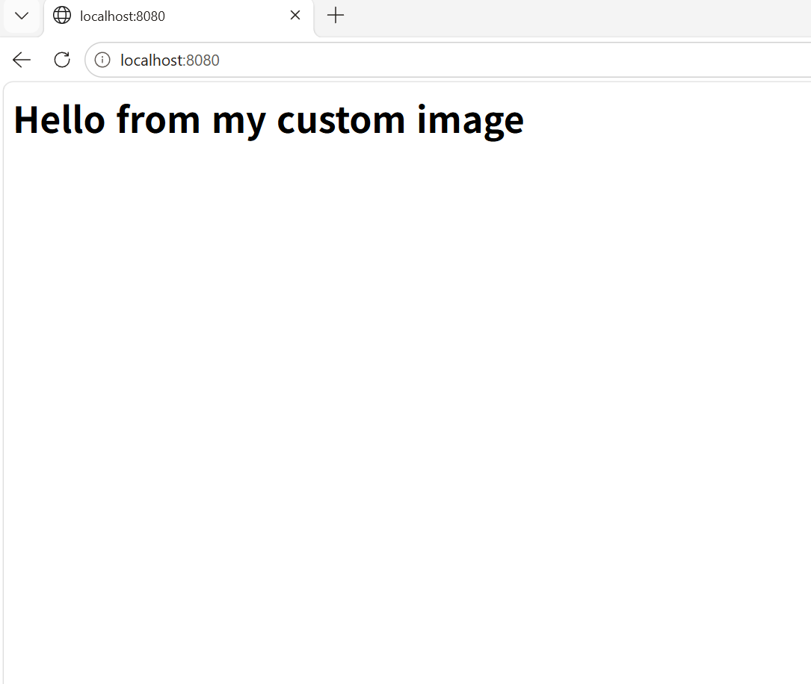
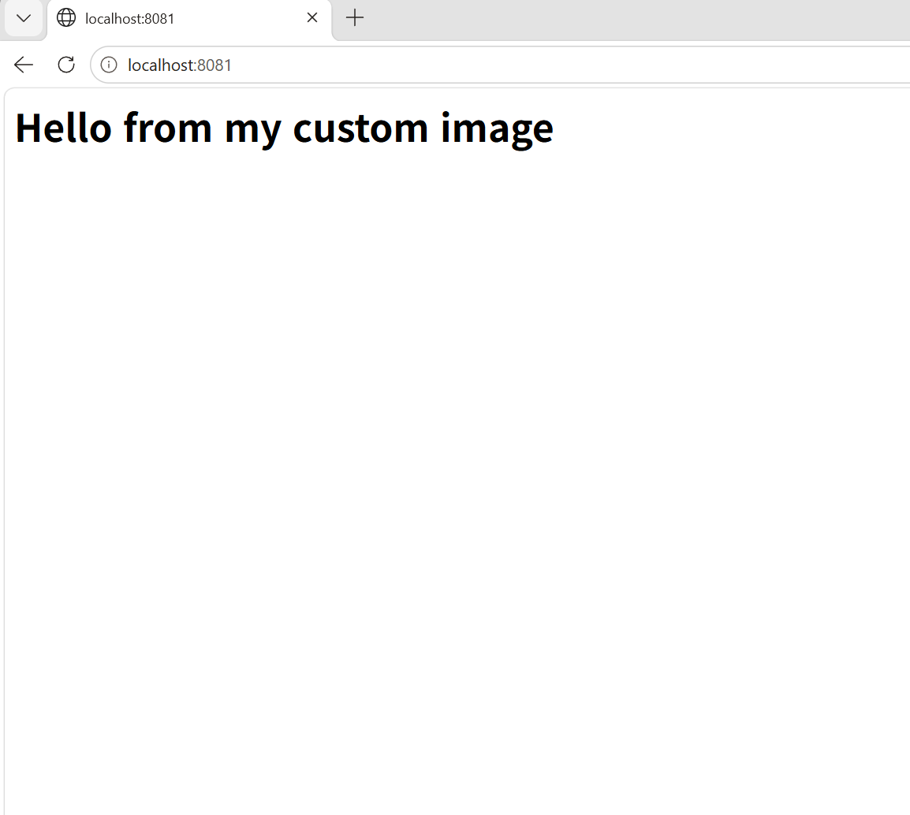
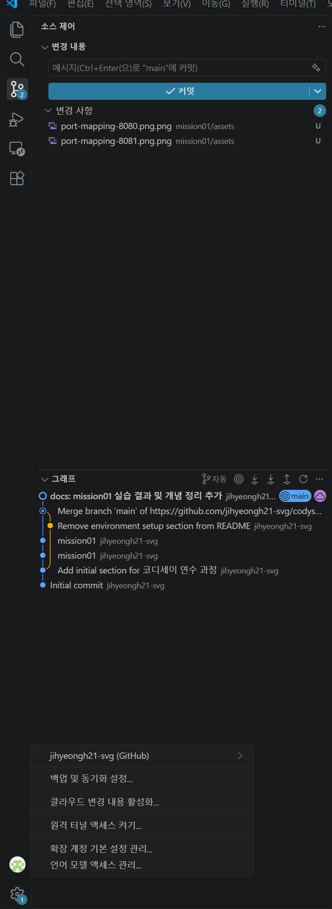

# 내 컴퓨터에 개발자용 '작업실' 꾸미기

> Codyssey 올인원 1기 입학 연수 — Pre-course Dev Setup Mission

## 📌 프로젝트 개요

- 터미널(CLI), Docker, Git/GitHub를 직접 세팅하여 재현 가능한 개발 워크스테이션을 구축한다.
- 이미지/컨테이너 분리, 포트·볼륨 연결 방식 등 컨테이너 환경의 구조적 원칙을 실습으로 검증한다.
- 모든 수행 과정과 검증 결과를 본 문서에서 확인할 수 있도록 기록한다.

---

## 1) 실행 환경

| 항목 | 값 |
|---|---|
| OS | Windows 11 Pro + WSL2 Ubuntu 24.04.5 LTS |
| Shell | bash (zsh + Oh My Zsh + Starship 설치 완료, 기본 쉘 전환 전) |
| 터미널 | VS Code 통합 터미널 (WSL: Ubuntu-24.04 연결) |
| Docker (또는 OrbStack) | Docker Desktop (WSL2 backend) — Docker version 29.9.2, build a82e528 |
| Git | git version 2.43.0 |

```bash
$ docker --version
Docker version 29.9.2, build a82e528

$ git --version
git version 2.43.0
```

---

## 2) 수행 체크리스트

- [x] 터미널 기본 조작 및 작업 디렉토리 구성
- [x] 파일/디렉토리 권한 확인 및 변경 실습
- [x] Docker 설치 및 데몬 동작 점검
- [x] Docker 기본 운영 명령 수행 (images / ps / logs / stats)
- [x] `hello-world`, `ubuntu` 컨테이너 실행 실습
- [x] Dockerfile 기반 웹 서버 컨테이너 빌드/실행
- [x] 포트 매핑 접속 확인 (2회 이상)
- [x] 브라우저 접속 스크린샷 (주소창 포함)
- [x] 바인드 마운트 변경 반영 검증
- [x] Docker 볼륨 영속성 검증 (컨테이너 삭제 전/후)
- [x] Git 사용자 정보 및 기본 브랜치 설정
- [x] GitHub SSH 키 등록 및 `ssh -T` 인증 확인
- [x] VSCode ↔ GitHub 로그인 스크린샷
- [x] 민감정보(토큰/비밀번호/개인키) 마스킹 최종 확인 (STEP 11)

---

## 2-1) 디렉토리 구조와 설계 기준

```text
codyssey-pre-dgree/
└── mission01/
    ├── README.md            # 수행 기록 (명령 + 출력 + 증거)
    ├── CONCEPTS.md          # 개념 정리
    ├── assets/              # 스크린샷 (README에서 참조)
    └── practice/
        ├── sample.txt       # 터미널/권한 실습 대상 파일
        ├── webapp/
        │   ├── Dockerfile   # nginx:alpine 기반 커스텀 이미지
        │   └── site/        # 정적 콘텐츠 (index.html)
        └── compose/
            ├── basic/       # 단일 서비스 Compose
            └── multi/       # web + redis + cache, 환경 변수
```

| 경로 | 목적 |
|---|---|
| `mission01/README.md` | 제출용 실행 기록. 모든 명령과 출력을 한곳에 모음 |
| `mission01/CONCEPTS.md` | 실습에서 쓴 개념(경로/권한/Docker/Git) 정리 노트 |
| `mission01/assets/` | README가 참조하는 스크린샷만 보관 |
| `mission01/practice/` | 실습 산출물 전용. 문서와 실습 파일을 분리 |
| `practice/webapp/` | 이미지 빌드 단위. `Dockerfile`과 빌드 컨텍스트(`site/`)를 한 폴더에 둠 |
| `practice/webapp/site/` | 컨테이너에 복사/마운트되는 정적 콘텐츠 |
| `practice/compose/basic`, `multi` | Compose 구성 단위별 폴더. 두 구성이 같은 포트를 써서 함께 실행하지 않는다 |

**설계 기준**
- 미션 단위 폴더(`mission01`)로 나눠 이후 미션이 추가돼도 충돌하지 않게 한다.
- **문서 / 증거 / 실습 파일을 분리**해서 문서만 읽어도 흐름이 보이고, 실습 파일만 실행해도 재현되게 한다.
- 빌드 컨텍스트를 `webapp/` 하나로 좁혀 `COPY`가 불필요한 파일을 이미지에 넣지 않게 한다.
- Compose 파일은 서비스 구성별 폴더로 나눠 `docker compose` 명령을 해당 폴더에서 실행한다(프로젝트 이름도 폴더명으로 구분됨).

---

## 3) 터미널 조작 로그

> 참고: 3)~4)의 로그는 `/home/gkwlgud129430` 계정 환경(11월 4일)에서 실행한 기록이고, 5) 이후는 현재 WSL 환경에서 다시 실행한 기록입니다. 경로 표기가 다른 이유입니다.

### 3-1. 작업 디렉토리 구성

```bash
$ pwd
# 현재 위치
/home/gkwlgud129430/codyssey-pre-dgree/mission01 ### 절대경로

$ mkdir -p ~/codyssey-pre-dgree/mission01/practice
$ cd ~/codyssey-pre-dgree/mission01/practice
$ ls -la ### 단순 파일 목록만 보기 옵션 제거 -la
# 결과
total 8
drwxr-xr-x 2 gkwlgud129430 gkwlgud129430 4096 Nov  4 15:07 .
drwxr-xr-x 3 gkwlgud129430 gkwlgud129430 4096 Nov  4 15:07 ..

```

### 3-2. 파일/디렉토리 생성·복사·이동·삭제

```bash
# 파일 생성
$ touch sample.txt
# 내용 삽입
$ echo "test" > sample.txt ### touch 명령어 과정 생략 가능
# 파일 내용 확인
$ cat sample.txt
# 결과
test


# 복사 / 이동·이름변경 / 삭제
$ cp sample.txt sample_copy.txt
$ mv sample_copy.txt renamed.txt ### 이동과  변경 동시 변경은 rename 따로 존재
$ ls
# 결과
renamed.txt  sample.txt
$ rm renamed.txt
$ ls
# 결과
sample.txt
```

---

## 4) 권한 실습 및 증거 기록

### 4-1. 파일 권한 변경

| 표기 | 의미 |
|---|---|
| `r` / `w` / `x` | 읽기 / 쓰기 / 실행   |
| `644` | 소유자 rw-, 그룹 r--, 기타 r-- |
| `755` | 소유자 rwx, 그룹 r-x, 기타 r-x |

*추가로 가장앞이 d 일경우 디렉토리 없을 경우 파일*

*파일종류(디렉토리/일반파일/소유자/그룹/기타 순으로 권한 표시*

> **숫자 선택 근거**: `444`는 모두 읽기 전용이라 "쓰기가 실제로 차단되는지" 확인하기에 가장 단순한 값이고, `644`는 일반 파일의 기본값(소유자만 쓰기, 나머지는 읽기)이라 원상 복구용으로 사용했다. 디렉토리는 `755`(소유자 rwx, 나머지 r-x)가 기본값이고, `555`는 쓰기 차단을 확인하려고 `w`만 제거한 값이다.


```bash
$ ls -l sample.txt
# 변경 전 권한 (예: -rw-r--r--)
-rw-r--r-- 1 gkwlgud129430 gkwlgud129430 5 Nov  4 15:13 sample.txt
### 일반파일/읽기쓰기/읽기/읽기 -> 숫자 변환 644(4+2/4/4)  
$ chmod 444 sample.txt
$ ls -l sample.txt
# 변경 후 권한
-r--r--r-- 1 gkwlgud129430 gkwlgud129430 5 Nov  4 15:13 sample.txt
# 실제 쓰기 불가능 한지 확인
$ echo "test2" > sample.txt
# 결과
permission denied: sample.txt
# 다시 쓰기 권한 부여
$ chmod 644 sample.txt
$ ls -l sample.txt
# 결과
-rw-r--r-- 1 gkwlgud129430 gkwlgud129430 6 Nov  4 15:53 sample.txt
$ echo "test2" > sample.txt
$ cat sample.txt
# 결과
test2

```


### 4-2. 디렉토리 권한 변경

```bash
$ ls -ld ~/codyssey-pre-dgree/mission01/practice
# 변경 전
drwxr-xr-x 2 gkwlgud129430 gkwlgud129430 4096 Nov  4 15:21 /home/gkwlgud129430/codyssey-pre-dgree/mission01/practice

$ chmod 555 ~/codyssey-pre-dgree/mission01/practice
$ ls -ld ~/codyssey-pre-dgree/mission01/practice
# 변경 후
dr-xr-xr-x 2 gkwlgud129430 gkwlgud129430 4096 Nov  4 15:21 /home/gkwlgud129430/codyssey-pre-dgree/mission01/practice
# 실제 쓰기 불가능 한지 확인 
$ touch test.txt  
# 결과
touch: cannot touch 'test.txt': Permission denied
```

---

## 5) Docker 설치 및 기본 점검

```bash
$ docker --version
# 결과
Docker version 29.9.2, build a82e528
$ docker info
# (또는 동등 점검 명령) 결과
 Version:    29.9.2
 Context:    desktop-linux
 Debug Mode: false
 ...
  Insecure Registries:
  hubproxy.docker.internal:5555
  127.0.0.0/8
  ::1/128
 Live Restore Enabled: false
 Firewall Backend: iptables

# 데몬/컨텍스트 요약 (현재 WSL 환경에서 다시 확인)
$ docker info | grep -E "Server Version|Operating System|Context|Containers:|Running:"
 Context:    default
 Containers: 2
  Running: 0
 Server Version: 29.9.2
 Operating System: Docker Desktop
```

- 요약: `docker info`가 `Server Version`을 반환하므로 **Docker 데몬이 정상 응답 중**이며, Docker Desktop 엔진을 사용한다.

---

## 6) Docker 기본 운영 명령 수행

```bash
# 이미지
$ docker images
# 결과
IMAGE   ID             DISK USAGE   CONTENT SIZE   EXTRA
# 컨테이너 실행/중지/목록
$ docker ps
$ docker ps -a
# 결과 (hello-world, ubuntu-test 실행 후)
CONTAINER ID   IMAGE         COMMAND                   CREATED         STATUS                              PORTS     NAMES
3170f9ae3c9c   ubuntu        "bash -c 'ls; echo \"…"   1 second ago    Exited (0) Less than a second ago             ubuntu-test
589bbe87dcaf   hello-world   "/hello"                  7 seconds ago   Exited (0) 6 seconds ago                      distracted_wozniak

# 운영: 로그/리소스 (STEP 8의 my-web 컨테이너 실행 중)
$ docker logs my-web
/docker-entrypoint.sh: Configuration complete; ready for start up
2026/11/10 00:45:45 [notice] 1#1: nginx/1.31.8
...
172.17.0.1 - - [10/Nov/2026:00:45:47 +0000] "GET / HTTP/1.1" 200 36 "-" "curl/8.5.0" "-"

$ docker stats --no-stream
CONTAINER ID   NAME      CPU %     MEM USAGE / LIMIT     MEM %     NET I/O         BLOCK I/O     PIDS
da97c4c13957   my-web    0.00%     21.59MiB / 15.25GiB   0.14%     1.76kB / 778B   0B / 8.19kB   25

# 이미지 목록 (실습 진행 후)
$ docker images
IMAGE                ID             DISK USAGE   CONTENT SIZE   EXTRA
basic-web:latest     faf2a950bb5d       93.7MB         26.4MB
hello-world:latest   c567b231f656       25.9kB         9.49kB   U
memcached:alpine     bfc2ee42c4ed         20MB         6.06MB
multi-web:latest     eaf3edb36309       93.7MB         26.4MB
my-web:1.0           99d8ef8f16f2       93.7MB         26.4MB
nginx:alpine         713fc2ebfd92       94.5MB         27.3MB
redis:alpine         71885d8cc6e4        162MB           40MB
ubuntu:latest        6a06111c3b0a        163MB         45.9MB   U
```

---

## 7) 컨테이너 실행 실습

### 7-1. hello-world

```bash
$ docker run hello-world
# 결과
Hello from Docker!
This message shows that your installation appears to be working correctly.

To generate this message, Docker took the following steps:
 1. The Docker client contacted the Docker daemon.
 2. The Docker daemon pulled the "hello-world" image from the Docker Hub.
    (amd64)
 3. The Docker daemon created a new container from that image which runs the
    executable that produces the output you are currently reading.
 4. The Docker daemon streamed that output to the Docker client, which sent it
    to your terminal.

To try something more ambitious, you can run an Ubuntu container with:
 $ docker run -it ubuntu bash

Share images, automate workflows, and more with a free Docker ID:
 https://hub.docker.com/

For more examples and ideas, visit:
 https://docs.docker.com/get-started/

```

### 7-2. ubuntu 컨테이너 진입 및 명령 실행

```bash
$ docker run -it --name ubuntu-test ubuntu bash
# 컨테이너 내부
$ ls
# 결과
bin  boot  dev  etc  home  lib  lib64  media  mnt  opt  proc  root  run  sbin  srv  sys  tmp  usr  var

$ echo "hello from container"
#결과
hello from container

$ exit
#결과
exit
```

### 7-3. attach / exec 차이 정리

- `docker exec`: 실행 중인 컨테이너에 새 프로세스로 진입 (여러 세션 가능)
- `docker attach`: 컨테이너의 메인 프로세스(PID 1)에 직접 연결

직접 관찰한 차이:

| 구분 | 종료 시 동작 | 이유 |
|---|---|---|
| `docker exec -it <name> bash` | 쉘을 `exit`해도 **컨테이너는 계속 실행**됨 | 메인 프로세스와 별개로 새로 띄운 프로세스만 종료되기 때문 |
| `docker attach <name>` | 종료하면 **컨테이너도 멈춤** | 메인 프로세스(PID 1)에 직접 붙어 있어서 그 프로세스가 끝나면 컨테이너도 끝나기 때문 |

- 컨테이너를 유지한 채 접속·점검하려면 `exec`, 메인 프로세스의 입출력을 그대로 보려면 `attach`를 사용한다.

---

## 8) 기존 Dockerfile 기반 커스텀 이미지 제작

- **선택한 기존 베이스**: `nginx:alpine` (경량 웹 서버 이미지)
- **적용한 커스텀 포인트**:
  1. `COPY site/ /usr/share/nginx/html/` — 기본 nginx 페이지를 직접 만든 정적 콘텐츠로 교체
  2. `ENV APP_ENV=dev`, `LABEL org.opencontainers.image.title` — 실행 모드 표시 및 이미지 메타데이터 부여

### 준비 (작업 디렉토리와 정적 콘텐츠)

```bash
$ mkdir -p ~/projects/codyssey-pre-dgree/mission01/practice/webapp/site
$ cd ~/projects/codyssey-pre-dgree/mission01/practice/webapp
$ echo "<h1>Hello from my custom image</h1>" > site/index.html
# 아래 Dockerfile을 이 디렉토리(webapp/)에 `Dockerfile` 이름으로 저장
```

### Dockerfile

```dockerfile
FROM nginx:alpine
LABEL org.opencontainers.image.title="my-custom-nginx"
ENV APP_ENV=dev
COPY site/ /usr/share/nginx/html/
```

### 빌드/실행 결과

```bash
$ docker build -t my-web:1.0 .
#5 [1/2] FROM docker.io/library/nginx:alpine@sha256:713fc2eb...
#6 [2/2] COPY site/ /usr/share/nginx/html/
#7 naming to docker.io/library/my-web:1.0 done

$ docker run -d -p 8080:80 --name my-web my-web:1.0
da97c4c13957899efc90b4c474070898fc7c057e677c9329f05fd83319b3f7b8

$ curl http://localhost:8080
<h1>Hello from my custom image</h1>

$ docker ps
CONTAINER ID   IMAGE        COMMAND                  CREATED         STATUS         PORTS                                     NAMES
da97c4c13957   my-web:1.0   "/docker-entrypoint.…"   2 seconds ago   Up 2 seconds   0.0.0.0:8080->80/tcp, [::]:8080->80/tcp   my-web
```

- **Dockerfile 위치**: [`mission01/practice/webapp/Dockerfile`](./practice/webapp/Dockerfile)
- **빌드 성공 핵심 메시지**: `#7 naming to docker.io/library/my-web:1.0 done` (위 빌드 로그 마지막 줄)

---

## 9) 포트 매핑 및 접속 증거

```bash
$ docker rm -f my-web   # STEP 6의 컨테이너가 8080을 쓰고 있으므로 먼저 제거
$ docker run -d -p 8080:80 --name my-web-8080 my-web:1.0
$ curl http://localhost:8080
<h1>Hello from my custom image</h1>   # 결과 1

$ docker run -d -p 8081:80 --name my-web-8081 my-web:1.0
$ curl http://localhost:8081
<h1>Hello from my custom image</h1>   # 결과 2 (2회 접속 증거)

$ docker ps
CONTAINER ID   IMAGE        COMMAND                  CREATED         STATUS         PORTS                                     NAMES
230c6a032793   my-web:1.0   "/docker-entrypoint.…"   2 seconds ago   Up 2 seconds   0.0.0.0:8081->80/tcp, [::]:8081->80/tcp   my-web-8081
b9fbe47d2e94   my-web:1.0   "/docker-entrypoint.…"   2 seconds ago   Up 2 seconds   0.0.0.0:8080->80/tcp, [::]:8080->80/tcp   my-web-8080
```

> nginx는 컨테이너 내부 **80 포트**에서 대기하므로 매핑은 `호스트포트:80`입니다. (`:5000`은 Flask 등 다른 앱용)





---

## 10) 바인드 마운트 반영 + 볼륨 영속성 증거

### 10-1. 바인드 마운트

```bash
$ cd ~/projects/codyssey-pre-dgree/mission01/practice/webapp
$ docker run -d -p 8082:80 -v $(pwd)/site:/usr/share/nginx/html --name bind-test nginx:alpine

# 변경 전
$ curl http://localhost:8082
<h1>Hello from my custom image</h1>

# 호스트에서 파일 변경
$ echo "<h1>updated content</h1>" > site/index.html
$ curl http://localhost:8082
<h1>updated content</h1>
# 컨테이너 재시작 없이 변경 반영됨
```

### 10-2. 볼륨 영속성

```bash
$ docker volume create mydata
$ docker run -d --name vol-test -v mydata:/data ubuntu sleep infinity
$ docker exec -it vol-test bash -lc "echo hi > /data/hello.txt && cat /data/hello.txt"
# hi

$ docker rm -f vol-test

# 컨테이너 삭제 후 재생성하여 데이터 유지 확인
$ docker run -d --name vol-test2 -v mydata:/data ubuntu sleep infinity
$ docker exec -it vol-test2 bash -lc "cat /data/hello.txt"
# hi (삭제 전/후 데이터 유지 확인)

# 볼륨 목록 / 상세 (컨테이너와 별개로 볼륨이 남아 있음)
$ docker volume ls
DRIVER    VOLUME NAME
local     mydata

$ docker volume inspect mydata
[
    {
        "CreatedAt": "2026-11-10T01:57:00Z",
        "Driver": "local",
        "Mountpoint": "/var/lib/docker/volumes/mydata/_data",
        "Name": "mydata",
        "Scope": "local"
    }
]
```

---

## 11) Git 설정 및 GitHub/VSCode 연동

```bash
$ git config --global user.name "jihyeongh21-svg"
$ git config --global user.email "<이메일>"
$ git config --global init.defaultBranch main
$ git config --global --list
user.email=<이메일>
user.name=jihyeongh21-svg
init.defaultbranch=main
core.autocrlf=input

# 저장소 루트에서 원격 URL 확인
$ git remote -v
origin	git@github.com:jihyeongh21-svg/codyssey-pre-dgree.git (fetch)
origin	git@github.com:jihyeongh21-svg/codyssey-pre-dgree.git (push)

# GitHub SSH 인증 확인 (공개키만 등록, 개인키는 노출하지 않음)
$ ssh -T git@github.com
Hi jihyeongh21-svg! You've successfully authenticated, but GitHub does not provide shell access.
```

VSCode GitHub 로그인(계정 메뉴) 및 소스 제어/커밋 그래프:



---

## 12) 트러블슈팅 (2건 이상)

### 트러블슈팅 #1

- **문제**: wsl 터미널에서 permission denied 도커 조작 실패 (`docker info` 실행 시 아래 오류 발생)
- **원인 가설**: 도커 설정에서 터미널에서 접급을 허용하는 옵션 비활성화 (Docker Desktop의 WSL Integration 미활성화)
- **확인**: docker desktop app 에서 설정 확인 (Settings → Resources → WSL Integration)
- **해결/대안**: Docker Desktop 앱 → Settings → Resources → WSL Integration에서 **"Enable integration with my default WSL distro"**를 활성화하고, 강제 재시작(재부팅)했다. 이후 wsl 완전 종료후 재실행 (`wsl --shutdown` → 재진입 → `docker info`로 확인)

원본 오류 로그 (1) — 명령 실행 시 권한 오류:

```text
permission denied while trying to connect to the docker API at unix:///var/run/docker.sock
```

원본 오류 로그 (2) — `docker info` 실행 시:

```text
Server:
ERROR: Error response from daemon: The command 'docker' could not be found in this WSL 2 distro.
We recommend to activate the WSL integration in Docker Desktop settings.
For details about using Docker Desktop with WSL 2, visit: https://docs.docker.com/go/wsl2/
errors pretty printing info
```

- `permission denied ... docker.sock`은 WSL에서 도커 소켓(`/var/run/docker.sock`)에 접근할 권한이나 연동이 없을 때 나온다. 일반 리눅스에서는 사용자를 `docker` 그룹에 넣어서 해결하지만, **Docker Desktop을 쓰는 WSL에서는 WSL Integration 활성화("Enable integration with my default WSL distro")와 강제 재시작**으로 해결했다.
- 오류 메시지가 "docker 명령을 이 WSL 배포판에서 찾을 수 없다"며 **WSL integration 활성화**를 직접 안내하고 있어, 원인 가설이 맞았음을 확인했다. 해결 후에는 `docker info`가 `Server Version`을 정상 출력한다(5) 참고).

### 트러블슈팅 #2

- **문제**: 포트 매핑이 제대로 되지 않아 도커 컨테이너와 로컬(호스트) 간 연결 실패
- **원인 가설**: `-p 호스트포트:컨테이너포트` 매핑이 잘못됨 (컨테이너 포트가 앱이 실제로 listen하는 포트와 다름)
- **확인**: `docker ps`의 PORTS 열에서 매핑을 확인 (nginx는 컨테이너 내부 80 포트 사용)
- **해결/대안**: 매핑을 수정(`-p 8080:80`)해 다시 실행 후 연결 정상 확인. 같은 호스트 포트를 쓰는 기존 컨테이너가 있으면 `docker rm -f`로 먼저 제거
- **포트 점유 진단 순서**: ① `docker ps`로 컨테이너 매핑 확인 → ② `ss -ltn | grep <포트>`(또는 `lsof -i :<포트>`, Windows는 `netstat -ano | findstr :<포트>`)로 OS 프로세스 확인 → ③ 점유 컨테이너는 `docker rm -f`, 다른 프로세스는 종료하거나 다른 호스트 포트 사용

재현 로그 (잘못된 매핑과 수정 후 비교. 당시 로그를 보관하지 않아 같은 증상을 다시 만들어 기록):

```bash
# 잘못된 매핑: 컨테이너 포트를 5000으로 지정 (nginx는 80에서 대기)
$ docker run -d -p 8099:5000 --name map-bad my-web:1.0
$ docker ps --format 'table {{.Names}}\t{{.Ports}}'
NAMES     PORTS
map-bad   0.0.0.0:8099->5000/tcp, [::]:8099->5000/tcp
$ curl -sS http://localhost:8099
curl: (56) Recv failure: Connection reset by peer
$ ss -ltn | grep 8099
LISTEN 0      4096                *:8099             *:*

# 수정: 컨테이너 포트를 80으로 지정
$ docker rm -f map-bad
$ docker run -d -p 8099:80 --name map-ok my-web:1.0
$ docker ps --format 'table {{.Names}}\t{{.Ports}}'
NAMES     PORTS
map-ok    0.0.0.0:8099->80/tcp, [::]:8099->80/tcp
$ curl -sS http://localhost:8099
<h1>Hello from my custom image</h1>
```

- 호스트 포트는 LISTEN 상태라 **포트가 열려 있어도 컨테이너 내부 포트가 틀리면 연결이 끊긴다**는 점이 증상의 특징이다.

---

## 13) 보너스 과제 (선택)

- [x] Docker Compose 기초 (`docker-compose.yml` 단일 서비스)
- [x] Docker Compose 멀티 컨테이너 (웹 서버 + 보조 서비스 2개 이상, 네트워크 통신 확인)
- [x] Compose 운영 명령어 (`up` / `down` / `ps` / `logs`)
- [x] 환경 변수 활용 (포트/모드 변경)
- [x] GitHub SSH 키 설정 및 동작 확인 (11)의 `ssh -T` 결과 참고)

파일 위치: `practice/compose/basic/docker-compose.yml`, `practice/compose/multi/docker-compose.yml` (빌드 대상은 8)의 `practice/webapp`)

### 13-1. Compose 기초 + 운영 명령어

```yaml
# practice/compose/basic/docker-compose.yml
services:
  web:
    build: ../../webapp
    ports:
      - "8080:80"
```

```bash
$ docker compose up -d --build
 Container basic-web-1 Started

$ docker compose ps
NAME          IMAGE       COMMAND                  SERVICE   CREATED         STATUS         PORTS
basic-web-1   basic-web   "/docker-entrypoint.…"   web       3 seconds ago   Up 2 seconds   0.0.0.0:8080->80/tcp, [::]:8080->80/tcp

$ curl http://localhost:8080
<h1>Hello from my custom image</h1>

$ docker compose logs --tail 3
web-1  | 2026/11/10 01:49:53 [notice] 1#1: start worker process 53
web-1  | 172.18.0.1 - - [10/Nov/2026:01:49:56 +0000] "GET / HTTP/1.1" 200 36 "-" "curl/8.5.0" "-"

$ docker compose down
 Container basic-web-1 Removed
 Network basic_default Removed
```

### 13-2. 멀티 컨테이너 + 네트워크 통신 (web + redis + cache)

```yaml
# practice/compose/multi/docker-compose.yml
services:
  web:
    build: ../../webapp
    environment:
      - APP_PORT=${APP_PORT:-8080}
      - APP_MODE=${APP_MODE:-dev}
    ports:
      - "${APP_PORT:-8080}:80"
    depends_on:
      - redis
      - cache
  redis:
    image: redis:alpine
  cache:
    image: memcached:alpine
```

```bash
$ docker compose up -d --build
$ docker compose ps
NAME            IMAGE              COMMAND                  SERVICE   STATUS         PORTS
multi-cache-1   memcached:alpine   "docker-entrypoint.s…"   cache     Up 3 seconds   11211/tcp
multi-redis-1   redis:alpine       "docker-entrypoint.s…"   redis     Up 3 seconds   6379/tcp
multi-web-1     multi-web          "/docker-entrypoint.…"   web       Up 3 seconds   0.0.0.0:8080->80/tcp, [::]:8080->80/tcp

$ docker compose exec web ping -c 2 redis
PING redis (172.18.0.3): 56 data bytes
64 bytes from 172.18.0.3: seq=0 ttl=64 time=0.068 ms
64 bytes from 172.18.0.3: seq=1 ttl=64 time=0.074 ms
2 packets transmitted, 2 packets received, 0% packet loss

$ docker compose exec web ping -c 2 cache
PING cache (172.18.0.2): 56 data bytes
64 bytes from 172.18.0.2: seq=0 ttl=64 time=0.067 ms
64 bytes from 172.18.0.2: seq=1 ttl=64 time=0.073 ms
2 packets transmitted, 2 packets received, 0% packet loss
```

- 같은 Compose 네트워크 안에서는 **서비스 이름이 호스트 이름**으로 동작해서 `redis`, `cache`로 바로 통신된다.
- `depends_on`은 시작 순서만 보장하며, 서비스가 "준비 완료"인지까지 기다리지는 않는다.

### 13-3. 환경 변수 활용 (포트/모드 변경)

```bash
$ docker compose down
$ APP_PORT=8090 APP_MODE=prod docker compose up -d
$ docker compose ps web
NAME          IMAGE       COMMAND                  SERVICE   STATUS         PORTS
multi-web-1   multi-web   "/docker-entrypoint.…"   web       Up 3 seconds   0.0.0.0:8090->80/tcp, [::]:8090->80/tcp

$ curl http://localhost:8090
<h1>Hello from my custom image</h1>

$ docker compose exec web printenv APP_PORT APP_MODE
8090
prod

$ docker compose down
```

- `${APP_PORT:-8080}`은 변수가 없으면 기본값 8080을 쓰는 문법이다. 같은 파일로 포트와 모드를 바꿔 실행할 수 있다.

---

## ⚠️ 보안 및 개인정보 보호

- 본 문서와 로그/스크린샷에는 토큰, 비밀번호, 개인키, 인증 코드 등이 포함되어 있지 않음을 확인했습니다.
- 민감정보가 노출된 경우 즉시 히스토리/문서에서 제거하고 재발급 절차를 수행했습니다. (해당 시)

### 보안 점검 로그

```bash
$ git log --oneline
d703e42 docs: mission01 실행 환경의 터미널 정보 기재
e160e27 docs: mission01 스크린샷 추가 및 README 이미지 연결
26fb3e6 docs: mission01 실습 결과 및 개념 정리 추가
...

$ grep -rniE "password|token|secret" . --include="*.md"
./mission01/CONCEPTS.md:131:- 점검: `git log --oneline`, `grep -ri "password\|token\|secret" . --include="*.md"`
# 점검 명령을 설명하는 문장만 일치 (실제 비밀값 없음)

$ grep -rnE "BEGIN [A-Z ]*PRIVATE KEY|AAAAC3NzaC1|ghp_|github_pat_" . --exclude-dir=.git
# 결과 없음 (개인키·공개키·토큰 패턴 없음)
```

- SSH 키는 저장소에 올리지 않았고, 개인키는 로컬 `~/.ssh`에만 존재 (GitHub에는 공개키만 등록)
- 스크린샷에는 GitHub 사용자 이름만 표시되고 토큰/인증 코드는 없음을 눈으로 확인
- Git 이메일은 README에 `<이메일>`로 마스킹함